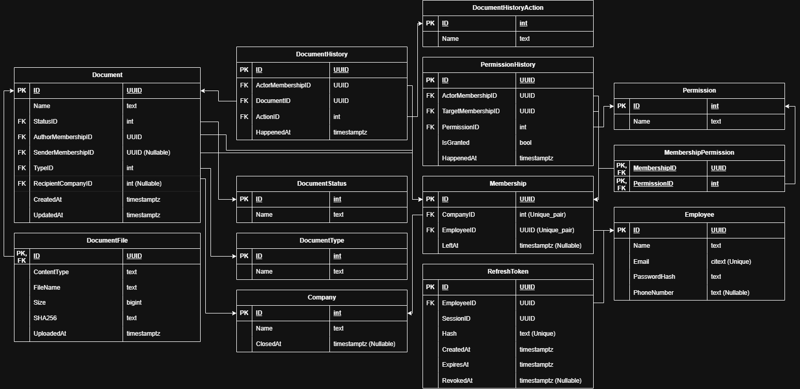

# ElectroDoc
Информационная система для электронного документооборота. Разработана с целью демонстрации навыков проектирования и разработки программных решений для бизнеса.

На данный момент находится в статусе ранней разработки. Спроектирована ERD и созданы шаблоны проектов, собранных в одном решении.

## Содержание
- [Технологии](#технологии)
- [Проектирование](#проектирование)

## Технологии
- Docker
- ASP.NET
- .NET SDK

## Проектирование
ERD проекта на данном этапе содержит основные сущности и их связи:
